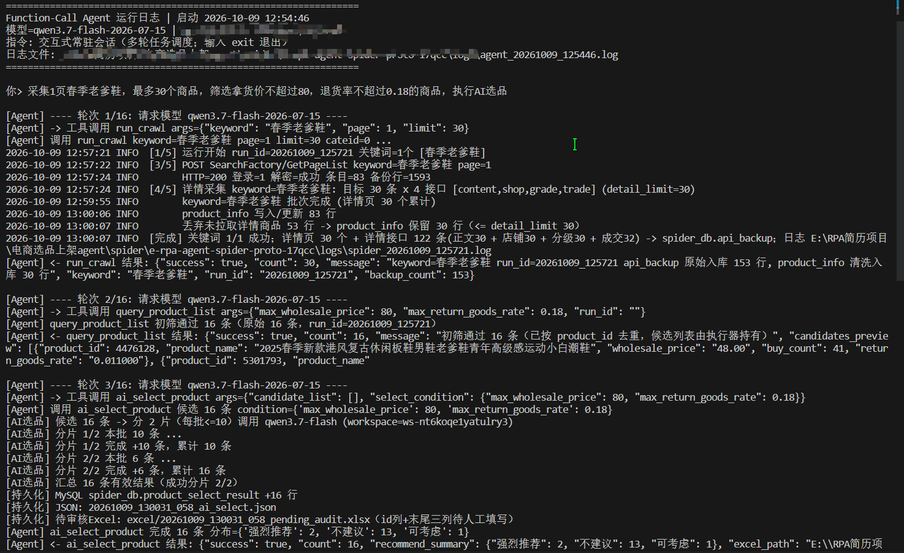
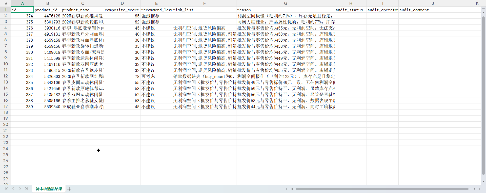
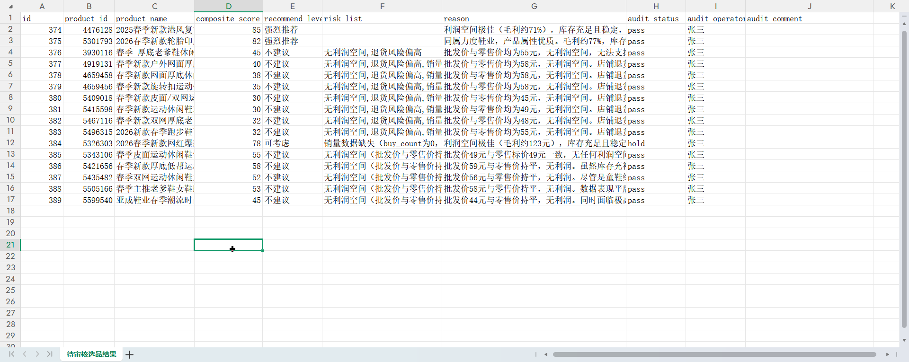
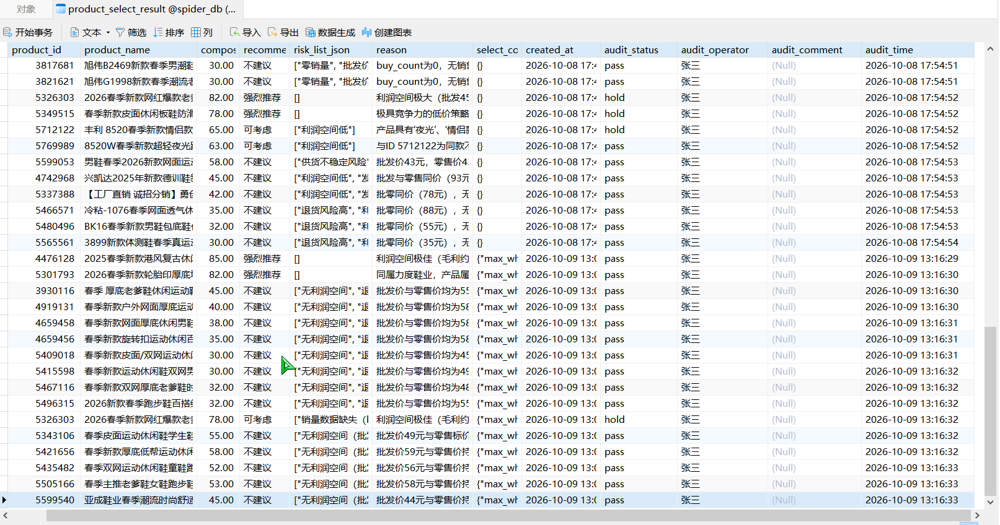
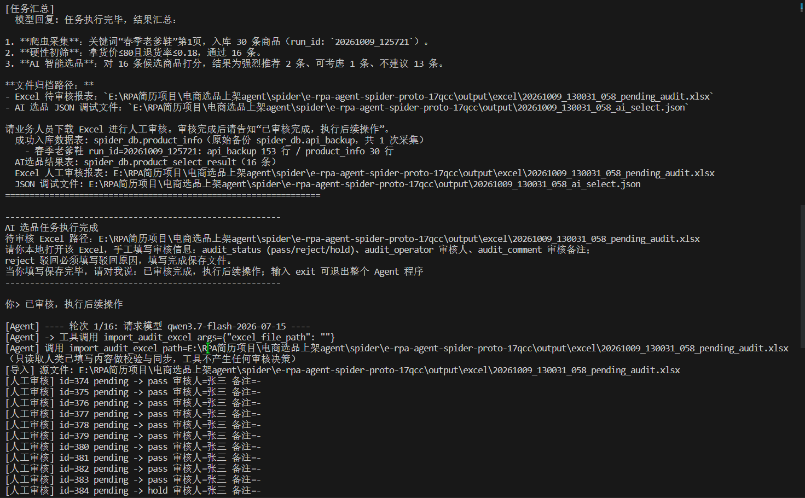
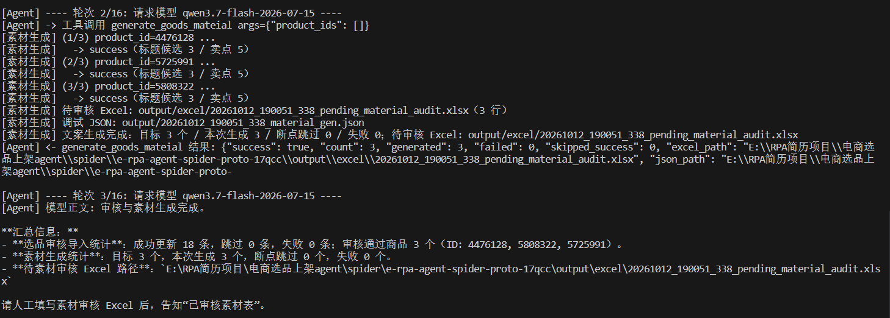
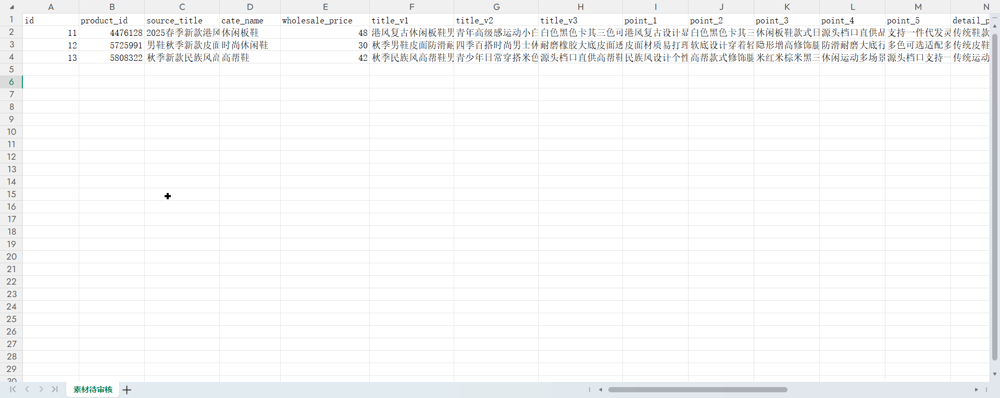
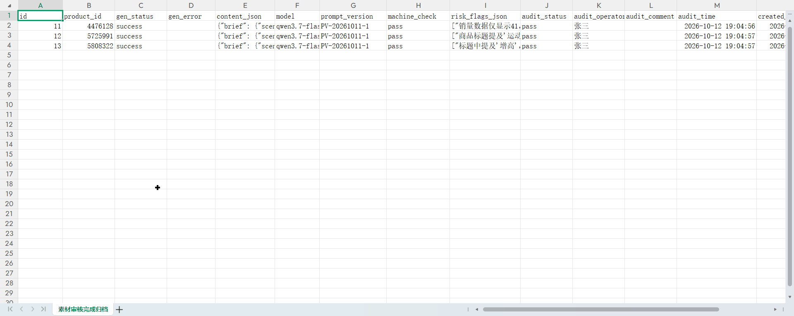
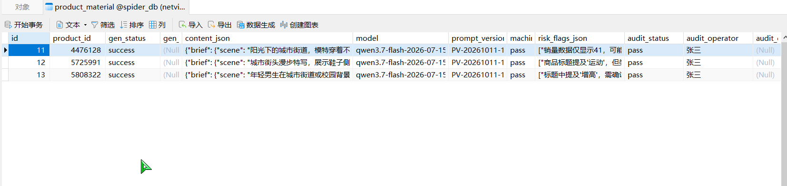

# 电商货源 AI 选品 Agent

> 个人学习 Demo，仅本地模拟运行，**不用于生产环境**。
> 技术栈：**Python + 通义千问 + MySQL + Requests**

一个把「货源采集 → 数据清洗 → 规则初筛 → AI 选品 → 人工审核 → AI 素材生成 → 素材审核」串成一条链路的本地选品 Agent：用纯 Python 手写 Function-Call 调度循环，不依赖 LangChain / Dify 等任何 Agent 框架。

---

## 2. 项目简介

**完整业务链路**

```
爬虫采集 → 清洗入库 → 数据库初筛 → 分片 AI 选品 → 人工审核 → AI 素材生成 → 素材审核
```

1. **爬虫采集**：按关键词抓取商品列表页与详情页数据，接口原始响应整行落库；
2. **清洗入库**：ETL 把原始报文汇总成干净的业务表，供后续筛选与评估；
3. **数据库初筛**：类目 / 拿货价 / 销量 / 退货率等硬性条件在 MySQL 层参数化过滤，先淘汰不合格货源；
4. **分片 AI 选品**：候选商品按批切片送入通义千问做多维度评估打分，自动分片防止单次上下文超限；
5. **人工审核闭环**：AI 只产出「待审核 Excel」，业务人员手工填写审核结论后导入回写，AI 不得替人决策；
6. **AI 素材生成**：对审核通过（`audit_status='pass'`）的商品自动生成上架文案素材（标题候选 / 短卖点 / 详情骨架 / brief），双状态维度（`gen_status` 机器生成 + `audit_status` 人工审核）落库；
7. **素材审核**：素材同样只产出待审核 Excel，人工填写后再导入回写，红线与选品审核一致。

**特性**

- **run_id 任务批次隔离**：每次采集生成独立 run_id，日志文件与三张数据表都按 run_id 隔离，多轮任务互不污染；
- **双模式运行日志**：`quiet` 模式（Agent 生产路径，只记业务关键点）与 `debug` 模式（本地调试，密钥/报文/明文只落文件不进控制台）；
- **AI 仅做评估，人工兜底审核**：模型只输出打分与推荐等级，pass/reject/hold 审核结论必须由人在 Excel 中填写，状态机校验 + 终态锁定；
- **输出 MySQL + JSON + Excel**：结构化结果进数据库，JSON 用于调试追溯，Excel 用于人工审核与业务归档；
- **纯 Python 工具调用链路**：手写「模型 → function_call 解析 → 工具执行 → 结果回填 → 多轮调度」循环，**不依赖 LangChain / Dify**。

---

## 3. 业务痛点

1. **选品靠人肉翻页，效率极低**：批发市场商品量巨大，运营逐页比对价格、销量、退货率，一轮选品要花数小时且容易漏掉好货；本项目用采集 + 规则初筛 + AI 打分把候选集压缩到可人工复核的规模。
2. **数据留不下来、也说不清来路**：接口原始报文和业务字段混在一起，出问题无法回溯；本项目用 `api_backup`（原始备份）+ `product_info`（清洗业务表）分层存储，配合 run_id 与接口调用追溯字段，随时可审计。
3. **一次把几十上百条商品塞给大模型会 token 爆炸**：单次超长上下文既贵又容易截断；本项目按批分片（每批 ≤ 12 条）循环评估，单批失败自动降级跳过，不拖垮整轮任务。
4. **AI 结果直接落地缺少人工兜底**：模型可能编造字段或给出不可靠结论；本项目让 AI 只做评估，审核状态由人在 Excel 中手工填写，导入时经状态机校验（reject 必填原因、终态禁止改写），AI 原始字段只读不可改。

---

## 4. 项目架构模块说明

- **爬虫模块 `src/collector/`**
  - 首页密钥引导 `bootstrap.py`、请求信封与加解密 `envelope.py` / `decode.py`
  - 列表与详情采集编排 `main.py`（支持断点续跑 `--resume`）、详情页 SSR 解析 `detail.py`
  - 清洗入库 `etl.py`（原始备份表 → 业务表）、登录态凭证 `session_login.py`
- **Agent 调度层 `src/agent/function_call_agent.py`**
  - 手写 Function-Call 循环与多轮常驻会话，跨轮保留 state（候选、run_id、Excel 路径）
  - 工具注册与编排：`run_crawl` → `query_product_list` → `ai_select_product` → `import_audit_excel` → `generate_goods_mateial` → `import_material_audit_excel`
    （另有预留工具 `simulate_goods_publish`，见第 10 节）
  - 调度日志双写 `logs/agent_<ts>.log`
- **AI 选品模块 `src/selector/`**
  - `product_selector.py`：MySQL 参数化硬性条件初筛（run_id 批次隔离）
  - `ai_selector.py`：通义千问分片评估、结构校验与防编造、结果持久化
- **人工审核模块 `src/selector/`**
  - `manual_audit.py`：审核状态机（唯一校验实现，终态锁定）
  - `excel_audit_import.py`：待审核 Excel 批量导入回写 + 归档 JSON/Excel
- **AI 素材生成模块 `src/material/`**
  - `generator.py`：审核通过商品 → 千问上架文案（标题候选/短卖点/详情骨架/brief），三层校验（结构/硬约束/事实核对）+ 断点续跑
  - `material_audit.py`：素材审核状态机（与选品审核同构，终态锁定）
  - `excel_material_import.py`：素材待审核 Excel 批量导入回写 + 归档
- **公共支撑 `src/common/`**：`logger.py`（双模式运行日志）、`database.py`（建库建表与参数化读写）

---

## 5. 数据库初始化

执行 `sql/init_table.sql` 一次性建库建表（幂等，可重复执行）：

```bash
mysql -uroot -p < sql/init_table.sql
```

或在 Python 中幂等执行：

```python
from src.common import database
database.init_schema("sql/init_table.sql")
```

包含四张表：

| 表名 | 作用 |
|---|---|
| `spider_db.api_backup` | 原始备份表：一次接口调用一行（原始响应 + 解密明文 + 一次性密钥） |
| `spider_db.product_info` | 清洗后业务表：ETL 汇总结果，初筛与 AI 选品的数据源 |
| `spider_db.product_select_result` | 选品结果表：AI 打分只增不改 + 人工审核四字段回写 |
| `spider_db.product_material` | 素材生成表：审核通过商品 → 千问文案；`gen_status`（机器生成）+ `audit_status`（人工审核）双状态维度 |

---

## 6. 部署运行步骤

```bash
# 1) 克隆仓库（替换为你的仓库地址）
git clone <你的仓库地址>
cd <仓库目录>

# 2) 安装依赖（建议 Python 3.10+）
pip install -r requirements.txt

# 3) 复制环境变量模板并填入自己的凭证
#    Windows:  copy config\.env.example config\.env
#    macOS/Linux:  cp config/.env.example config/.env
#    编辑 config/.env，填入 DASHSCOPE_API_KEY、DB_HOST/DB_PORT/DB_USER/DB_PASSWORD/DB_NAME

# 4) 建表
mysql -uroot -p < sql/init_table.sql

# 5) 启动 Agent（在项目根目录执行）
python -m src.agent.function_call_agent
```

启动后是常驻交互会话，直接输入自然语言指令即可，例如：

```text
你> 帮我采集“春季板鞋男”和“春季老爹鞋男”各 1 页，每词取前 20 个商品，
    然后初筛：拿货价不超过 50 元、销量不低于 50、退货率低于 5%，做 AI 选品
你> 已审核完成，执行后续操作
你> 已审核素材表，执行后续操作
你> exit
```

> 首轮会依次执行：采集入库 → 数据库初筛 → 分片 AI 选品 → 生成待审核 Excel；
> 你线下用 Excel 填完 `audit_status` / `audit_operator` / `audit_comment` 保存后，
> 输入「已审核完成，执行后续操作」完成回写并自动生成文案素材（产出素材待审核 Excel）；
> 再线下填完素材审核 Excel，输入「已审核素材表，执行后续操作」完成素材回写；
> 输入 `exit` 退出。

其他常用入口：

```bash
python -m src.collector.main --keyword 春季男鞋 --page 1   # 单独跑爬虫（debug 日志模式）
python -m src.collector.main --resume <run_id> --keyword 春季男鞋   # 中断后续跑（见下）
python -m src.selector.product_selector                    # 单独跑数据库初筛演示
python src/selector/excel_audit_import.py --file output/excel/<文件名>_pending_audit.xlsx
```

### 断点续爬（采集中断后原地续跑）

采集中途因 Ctrl+C、网络异常或登录态过期中断后，无需整批重跑——用原 `run_id` 续跑，已完成部分自动跳过、只补缺：

```bash
# run_id 见日志首行（run_id=yyyymmdd_hhmmss）；关键词/类目须与原运行一致
python -m src.collector.main --resume <run_id> --keyword 春季板鞋男
```

Agent 对话里同样支持：说「继续采集上次中断的批次，run_id 是 xxx」，模型会调用 `run_crawl(keyword=..., resume="<run_id>")` 完成续跑，返回结果带「（断点续跑）」标记。

实现思路：以原始备份表 `api_backup` 的成功行（`decrypt_ok=1`）为断点事实源——列表已完成的关键词直接复用备份明文（不重发请求），详情按「商品 × 接口域」粒度缺哪补哪；末尾 ETL 幂等重跑收口，业务表结果与一次跑完一致。典型场景：**登录态过期导致详情页只剩游客占位 → 刷新登录凭证后 `--resume` 自动补齐**。

---

## 7. 输出产物说明

| 产物 | 位置 | 说明 |
|---|---|---|
| 待审核 Excel | `output/excel/<时间戳>_pending_audit.xlsx` | 首列为数据库主键 `id`，末尾 `audit_status` / `audit_operator` / `audit_comment` 三列留空供人工填写 |
| 归档 JSON | `output/json_dump/<时间戳>_finished_audit.json` | 审核回写后按处理 id 拉取的全量最新数据 |
| 归档 Excel | `output/excel/<时间戳>_finished_audit.xlsx` | 数据库真实最新状态，业务留存 |
| 调试 JSON | `output/<时间戳>_ai_select.json` | AI 选品原始输出与分片信息，便于追溯 |
| 素材待审核 Excel | `output/excel/<时间戳>_pending_material_audit.xlsx` | 文案素材（标题/卖点/详情/brief）待人工审核，末尾三列留空 |
| 素材归档 JSON/Excel | `output/json_dump/<时间戳>_finished_material_audit.json`、`output/excel/<时间戳>_finished_material_audit.xlsx` | 素材审核回写后的归档 |
| 素材调试 JSON | `output/<时间戳>_material_gen.json` | 千问文案生成原始输出，便于追溯 |
| 运行日志 | `logs/spider_<run_id>.log`、`logs/agent_<ts>.log` | 爬虫/选品日志与 Agent 调度日志 |
| 数据库存储 | `spider_db.api_backup` / `product_info` / `product_select_result` / `product_material` | 原始备份、清洗业务数据、AI 结果与人工审核状态、文案素材 |

---

## 8. ⚠️ 重要注意事项

- **禁止把真实密钥提交到 GitHub**：`config/.env` 已被 `.gitignore` 排除，任何 API-KEY、数据库账号密码、登录态 Cookie 只允许写在 `config/.env` 或系统环境变量里；提交前请确认 `git status` 中没有 `.env`、`logs/`、`output/`、`js_reverse_cache/` 等被忽略目录的内容。
- 本项目**仅作个人学习演示**，所有运行均在本地模拟，不对接任何生产系统、不对外提供服务。
- 采集目标站点的数据仅用于本地分析演示，请遵守目标网站的服务条款与访问频率限制。
- AI 结果仅供辅助参考，**任何采购决策必须经人工复核**。

---

## 9. 项目运行截图

<!-- 1.控制台运行截图（Agent 启动、采集进度、AI 选品汇总） -->
**控制台运行截图**



<!-- 2：待审核 Excel 截图（id + AI 字段 + 三列空审核列） -->
**Excel 选品待审核报表截图**



<!-- 3：已审核 Excel 截图（id + AI 字段 + 三列审核列【状态，审核人，理由】） -->
**Excel 选品已审核报表截图**



<!-- 4：MySQL选品结果表 -->
**数据库查询截图**



<!-- 5：Excel审核结果回写数据库交互 -->



<!-- 6.控制台运行截图（Agent AI 素材汇总） -->



<!-- 7：待审核 Excel 截图（id + AI 字段 + 三列空审核列） -->

**Excel 素材待审核报表截图**



<!-- 8：已审核 Excel 截图（id + AI 字段 + 三列空审核列） -->

**Excel 素材已审核报表截图**



<!-- 9：MySQL素材结果表 -->
**数据库查询截图**



---

## 10. 待开发功能

P1 素材（文案）生成已实现（`generate_goods_mateial` + `import_material_audit_excel`，见第 4 节 `src/material/`）。Agent 调度层仍预留一个工具槽位（`src/agent/function_call_agent.py` 中的 `simulate_goods_publish`），当前调用只会返回「待后续迭代实现」：

| 功能 | 预留工具 | 规划说明 |
|---|---|---|
| **商品上架** | `simulate_goods_publish(product_ids)` | 素材确认后进入商品上架流程：先实现**本地模拟发布**（记录上架参数与结果），再评估对接真实店铺后台接口 |

说明：

- 预留工具与主链路（采集 → 初筛 → AI 选品 → 人工审核 → 素材生成 → 素材审核）解耦，可独立迭代，不影响现有功能；
- 审核红线不变：**是否上架、是否采用生成的文案，最终由人工决定**，AI 只产出候选素材；
- 涉及真实店铺发布的部分属于生产用途，本仓库仅保留本地模拟实现（见第 8 节注意事项）。
